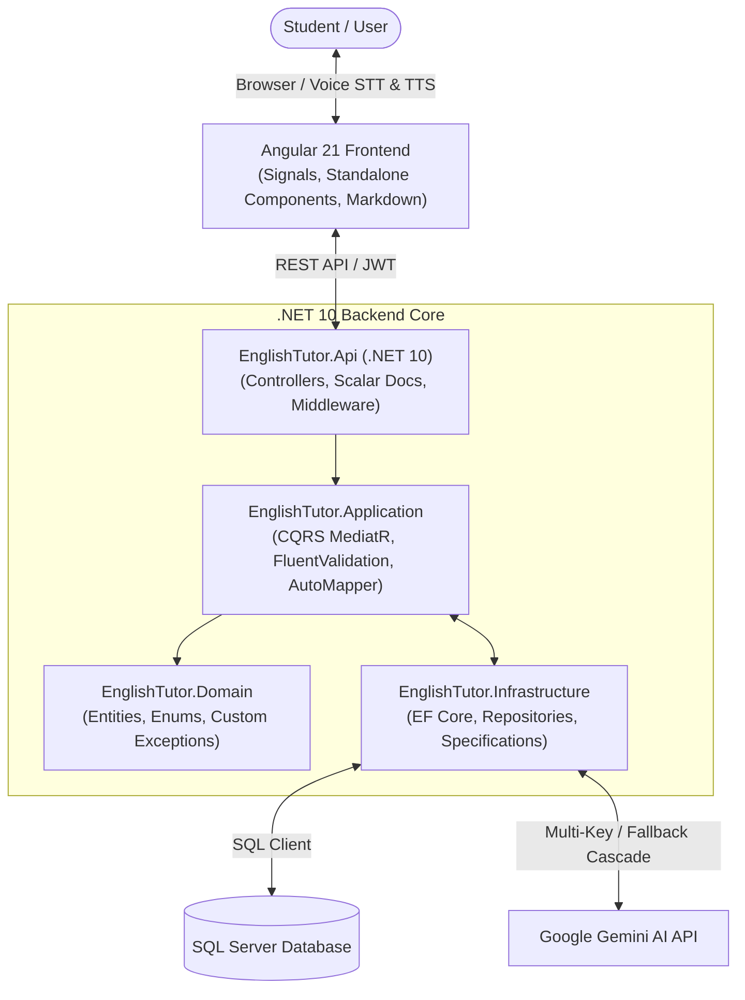

# 🎓 EnglishTutor AI — Intelligent English Learning Platform

[](https://dotnet.microsoft.com/)
[](https://angular.dev/)
[](https://www.typescriptlang.org/)
[](https://ai.google.dev/)
[](https://learn.microsoft.com/ef/core/)
[](https://scalar.com/)
[](LICENSE)

> An interactive, AI-powered English tutoring web application tailored for preparatory school students and ESL/EFL learners. Powered by **Google Gemini AI**, a robust **.NET 10 Clean Architecture** backend, and a reactive **Angular 21** frontend with real-time voice speech recognition and audio playback.

---

## 🌟 Key Features

### 🧠 Dual AI Learning Modes
- ⚡ **Quick Mode**: Provides immediate, concise single-word or short-phrase corrections (ideal for quick homework checks, multiple-choice drills, and fast quizzes).
- 📖 **Detailed Mode**: Delivers structured, step-by-step pedagogical explanations tailored to preparatory/middle-school level. Includes:
  - Simple Arabic explanations (**شرح مبسط باللغة العربية**)
  - English examples with everyday context
  - Core grammar rules (**قاعدة الدرس**)
  - Common pitfalls to avoid (**أخطاء شائعة**)

### 🎙️ Voice & Pronunciation Support
- **Speech-to-Text (STT)**: Students can speak their questions using the Web Speech API directly into the app.
- **Text-to-Speech (TTS)**: Listen to English tutor responses with native audio pronunciation to enhance listening and speaking skills.

### 💬 Chat Sessions & Lesson History
- Organize learning into dedicated sessions (e.g., *Grammar Review*, *Past Simple Practice*, *Vocabulary*).
- Full conversation history persistence using **SQL Server** and **EF Core**.
- Create, rename, switch, and delete sessions with reactive state updates.

### 🛡️ Multi-Key & Multi-Model AI Resilience
- **Round-Robin Multi-Key Rotation**: Automatically balances load across multiple Google Gemini API keys to avoid quota exhaustion.
- **Dynamic Failover Cascade**: Seamlessly falls back across models (`gemini-2.5-flash`, `gemini-flash-latest`, `gemini-flash-lite`, etc.) in case of rate limits (HTTP 429).
- **Offline Simulation Fallback**: Gracefully provides simulated tutoring answers when operating in offline or test environments.

### 🔐 Secure & Modern Architecture
- **JWT Authentication**: User registration and login with secure token-based authorization.
- **Interactive API Documentation**: Embedded **Scalar API Reference** accessible at `/scalar/v1`.

---

## 🏛️ System Architecture

The project adheres strictly to **Clean Architecture** principles and **CQRS (Command Query Responsibility Segregation)** with MediatR:



### Layer Breakdown
- **`EnglishTutor.Domain`**: Core domain entities (`ApplicationUser`, `ChatSession`, `ChatMessage`), domain enums (`AnswerMode`, `MessageRole`), and domain exceptions.
- **`EnglishTutor.Application`**: CQRS commands & queries, MediatR handlers, validation behaviors, DTOs, and interface definitions.
- **`EnglishTutor.Infrastructure`**: Persistence (`TutorDbContext`), Entity Framework Core configurations, repository implementations, Specification evaluators, JWT token service, and `GeminiAiTutorService`.
- **`EnglishTutor.Api`**: REST API endpoints, JWT bearer configuration, exception middleware, and Scalar API documentation.
- **`frontend/english-tutor`**: Angular 21 client built with Standalone Components, Signals, reactive services, and responsive CSS.

---

## 💻 Tech Stack

| Domain | Technology / Library | Description |
| :--- | :--- | :--- |
| **Backend Framework** | [.NET 10 (C# 13)](https://dotnet.microsoft.com/) | High-performance, modern web API |
| **Architecture** | Clean Architecture + CQRS | Loose coupling & testable domain logic |
| **Mediation & Mapping** | MediatR 14 & AutoMapper 16 | Decoupled request handlers & object mapping |
| **Validation** | FluentValidation 12 | Strong input validation pipelines |
| **Database & ORM** | Entity Framework Core 10 + SQL Server | Code-first data persistence & migrations |
| **AI Integration** | Google Gemini API (v1beta) | Generative AI tutor with multi-key failover |
| **Authentication** | ASP.NET Core JWT Bearer | Secure stateless token authentication |
| **API Docs** | Scalar (OpenAPI 3.0) | Interactive API exploration & test runner |
| **Frontend Framework** | [Angular 21](https://angular.dev/) | Signals-based reactive UI |
| **Voice Engine** | Web Speech API | Native SpeechRecognition & SpeechSynthesis |
| **Markdown** | Marked.js | Formatted lesson notes & explanations |

---

## 📁 Repository Structure

```text
chatboot/
├── backend/
│   ├── EnglishTutor.Api/              # Presentation layer (Controllers, Program.cs, Middleware)
│   │   ├── Controllers/               # Account, ChatSessions, ChatMessages
│   │   ├── appsettings.example.json   # Configuration template
│   │   └── Program.cs
│   ├── EnglishTutor.Application/      # Business logic (Commands, Queries, Validators)
│   │   ├── Features/                  # CQRS slices (Accounts, ChatSessions, ChatMessages)
│   │   └── Interfaces/                # Service & Repository contracts
│   ├── EnglishTutor.Domain/           # Domain layer (Entities, Enums, Exceptions)
│   │   └── Entities/                  # ApplicationUser, ChatSession, ChatMessage
│   ├── EnglishTutor.Infrastructure/   # External concerns (EF Core, Gemini, Auth)
│   │   ├── Persistence/               # TutorDbContext & Migrations
│   │   └── Services/                  # GeminiAiTutorService, TokenService
│   └── EnglishTutor.Api.sln           # Visual Studio Solution
│
├── frontend/
│   └── english-tutor/                 # Angular 21 Client application
│       ├── src/
│       │   ├── app/
│       │   │   ├── core/              # Services (Auth, Chat, Voice), Guards, Interceptors
│       │   │   ├── features/          # Auth (Login/Register) & Chat workspace
│       │   │   └── shared/            # Reusable pipes (Markdown) & components
│       │   └── environments/          # Environment configurations
│       ├── package.json
│       └── angular.json
│
├── .gitignore                         # Git exclusion rules
└── README.md                          # Project documentation
```

---

## 🚀 Getting Started

### Prerequisites

Ensure you have the following installed on your machine:
- [.NET 10 SDK](https://dotnet.microsoft.com/download)
- [Node.js (v20+ or v22 LTS)](https://nodejs.org/) & `npm`
- [Angular CLI](https://angular.dev/tools/cli) (`npm install -g @angular/cli`)
- [SQL Server](https://www.microsoft.com/sql-server/) (LocalDB, Express, or Azure SQL)
- A Google Gemini API Key from [Google AI Studio](https://aistudio.google.com/)

---

### 1. Backend Setup

1. **Navigate to the API folder:**
   ```bash
   cd backend/EnglishTutor.Api
   ```

2. **Configure Settings:**
   Copy `appsettings.example.json` to `appsettings.json` (or edit existing `appsettings.json`):
   ```bash
   cp appsettings.example.json appsettings.json
   ```
   Set your connection string and your Gemini API keys:
   ```json
   {
     "ConnectionStrings": {
       "DefaultConnection": "Server=localhost;Database=EnglishTutorDb;Trusted_Connection=True;TrustServerCertificate=True;"
     },
     "JwtSettings": {
       "SecretKey": "YOUR_STRONG_SECRET_KEY_MIN_32_CHARACTERS"
     },
     "GeminiSettings": {
       "Model": "gemini-2.5-flash",
       "ApiKeys": [
         "YOUR_GEMINI_API_KEY_HERE"
       ]
     }
   }
   ```

3. **Apply Database Migrations:**
   ```bash
   dotnet ef database update --project ../EnglishTutor.Infrastructure
   ```

4. **Run the Backend API:**
   ```bash
   dotnet run
   ```
   The API will start at `http://localhost:5082` (or configured HTTPS port).
   - View Interactive API Documentation: `http://localhost:5082/scalar/v1`

---

### 2. Frontend Setup

1. **Navigate to the frontend folder:**
   ```bash
   cd frontend/english-tutor
   ```

2. **Install Dependencies:**
   ```bash
   npm install
   ```

3. **Verify Environment Config:**
   Check `src/environments/environment.ts` to ensure the API URL points to your backend:
   ```typescript
   export const environment = {
     production: false,
     apiUrl: 'http://localhost:5082/api'
   };
   ```

4. **Start the Development Server:**
   ```bash
   npm start
   # or: ng serve --open
   ```
   Open your browser at `http://localhost:4200/`.

---

## 📡 API Reference Overview

The backend exposes RESTful endpoints with unified responses (`ApiResponse<T>`):

| Method | Endpoint | Description | Auth Required |
| :--- | :--- | :--- | :---: |
| `POST` | `/api/account/register` | Register a new student account | ❌ No |
| `POST` | `/api/account/login` | Login and receive a JWT Bearer token | ❌ No |
| `GET` | `/api/account/me` | Fetch authenticated student profile | ✅ Yes |
| `GET` | `/api/sessions` | List all chat sessions for the logged-in user | ✅ Yes |
| `POST` | `/api/sessions` | Create a new learning session | ✅ Yes |
| `GET` | `/api/sessions/{id}` | Retrieve messages for a specific session | ✅ Yes |
| `DELETE` | `/api/sessions/{id}` | Delete a session and its message history | ✅ Yes |
| `POST` | `/api/sessions/{sessionId}/messages` | Send question to AI tutor (Quick or Detailed mode) | ✅ Yes |

Interactive API specifications and sandbox testing are available at `/scalar/v1` when running the backend.

---

## 🔒 Security Best Practices

> [!WARNING]
> Never commit your production `appsettings.json` or real Gemini API keys to a public GitHub repository.

- Always keep sensitive API keys, JWT secrets, and database credentials out of version control.
- Use `.gitignore` to prevent secret leakage.
- In production, configure secrets via **Environment Variables** or **Azure Key Vault** / **User Secrets**.

---

## 🤝 Contributing

Contributions, feedback, and suggestions are warmly welcomed!
1. Fork the Project
2. Create your Feature Branch (`git checkout -b feature/AmazingFeature`)
3. Commit your Changes (`git commit -m 'Add some AmazingFeature'`)
4. Push to the Branch (`git push origin feature/AmazingFeature`)
5. Open a Pull Request

---

## 📄 License

This project is licensed under the MIT License — see the [LICENSE](LICENSE) file for details.
